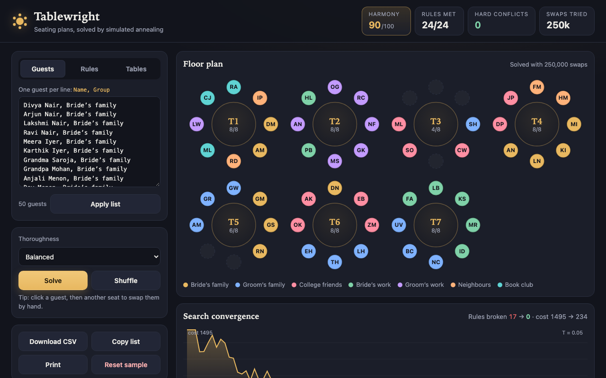

# Tablewright

> Seat 50 guests in seconds: simulated annealing untangles couples, cliques and feuds

**[▶ Try the live demo](https://ashwin2310.github.io/one-app-a-day/apps/2026-11-11/)** · Category: 🧠 Problem solving / AI · Day 1 · 2026-11-11

📋 [Read the storyboard](STORYBOARD.md): how the idea was planned, screen by screen.

## The problem

Anyone planning a wedding, gala or team dinner ends up shuffling sticky notes for hours, trying to keep couples side by side, friend groups together and feuding relatives far apart. With 50 guests and 7 tables there are more possible arrangements than atoms in the universe, so every manual fix breaks something else. Spreadsheets and drag-and-drop planners only record a plan; they never tell you whether a better one exists.

**Who it's for:** Couples planning a wedding, event organisers and anyone who has to seat a room full of people with opinions.

## The solution

Tablewright turns your guest list and a few plain-language rules (sit next to, same table, keep apart) into a cost function, then runs simulated annealing in your browser to search millions of seat swaps for the arrangement with the fewest conflicts. You watch the floor plan rearrange itself live while red conflict lines disappear, then pin anyone you want fixed, fine-tune by hand and export the final chart.

## How it works

1. Every rule becomes a weighted penalty: a couple split across tables costs 100, a couple at the same table but not adjacent costs 6, two people who must be kept apart sharing a table costs 100, and splitting a friend group costs 2 per pair.
2. The plan is a flat array of seats; round-table adjacency is seat i and seat i plus or minus one, wrapping around the table.
3. Simulated annealing proposes swapping two random seats (including empty ones), computes the cost change from only the rules touching those two guests, and accepts worse moves with probability e^(-delta/T) so it can escape local traps.
4. The temperature cools geometrically from 60 to 0.05 over hundreds of thousands of swaps, run in small batches per animation frame so the UI stays smooth and you can watch it converge.
5. The best arrangement seen is kept and restored at the end; pinned guests never move.

## Features

- Live animated floor plan: guests glide between round tables while conflict lines turn from red to gone
- Plain-language rules: sit next to, same table, keep apart, plus automatic friend-group cohesion
- Harmony score, rules met, hard conflicts and a live convergence chart of the search
- Click a guest to see their rules, swap them with anyone by hand, or pin them to a seat
- Bulk guest entry (one 'Name, Group' per line), adjustable table count and seats per table
- Export as CSV or copy a clean table-by-table list, with a print-friendly layout
- Everything autosaves in your browser; nothing leaves your device

## Under the hood

- Simulated annealing written from scratch with O(rules per guest) incremental delta scoring, so 300,000 swaps take well under two seconds
- Typed arrays for seat and position maps, plus a stamp array to deduplicate shared rules in each delta without allocating
- requestAnimationFrame-batched solver with a fixed frame budget so the animation length is the same for 10 or 300 guests
- Keyed SVG guest nodes with CSS transform transitions, giving smooth motion without a framework
- Zero dependencies: plain HTML, CSS and JavaScript with localStorage persistence

Built with plain HTML, CSS and vanilla JavaScript: no frameworks, no build step, no backend.

## Try it yourself

1. Open the app: a 50-guest wedding is seated automatically while you watch
2. Press Shuffle to scramble everyone and see the red conflict lines, then press Solve
3. Click Uncle Victor, read his rules, and press Pin to lock him in place
4. Open the Rules tab and add 'Keep apart' between two guests at the same table, then solve again
5. Export the result as CSV or copy the table list

## Run it locally

Download this folder and open `index.html` in any browser. That's it.

---

Part of a daily build series: one new app every day, planned, storyboarded and built with Claude Code, then published automatically.
