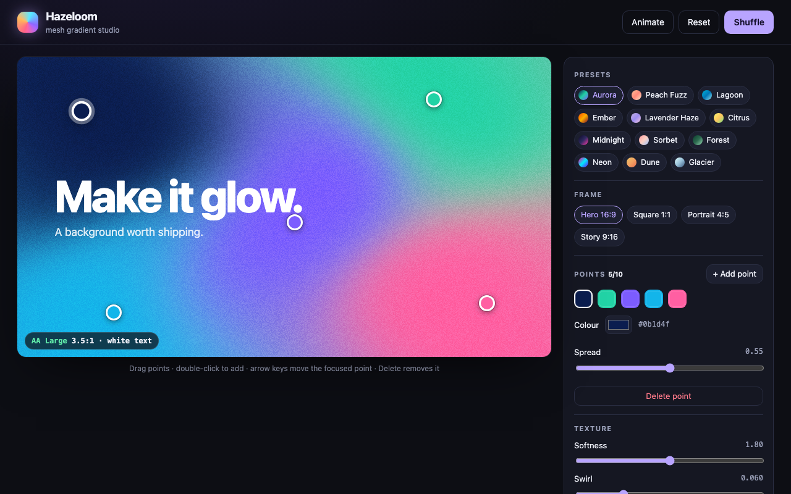

# Hazeloom

> Paint silky mesh gradients by dragging colour points, then export CSS, SVG or PNG.

**[▶ Try the live demo](https://ashwin2310.github.io/one-app-a-day/apps/2026-11-12/)** · Category: 🎨 Design · Day 2 · 2026-11-12

📋 [Read the storyboard](STORYBOARD.md): how the idea was planned, screen by screen.

## The problem

Soft 'mesh' gradients are everywhere in modern UI, hero sections and social graphics, but CSS has no native mesh gradient and most generators are paid, locked inside a design tool, or blend colours in sRGB so the midpoints turn muddy grey. Designers and front-end developers end up screenshotting backgrounds or hand-tuning stacks of radial-gradients by trial and error.

**Who it's for:** Designers, front-end developers and content creators who need a beautiful custom gradient background in under a minute.

## The solution

Hazeloom renders a live mesh gradient from a handful of draggable colour points, blending them in the perceptual OKLab colour space so transitions stay vivid. You tune spread, softness, swirl and film grain, check how a headline reads on top with an automatic WCAG contrast badge, and export the result as copy-ready CSS, a scalable SVG or a full-resolution PNG.

## How it works

1. Each colour point has a position, a colour and a spread radius; the canvas is a weighted field where every pixel's weight for a point falls off with distance relative to that point's spread.
2. Colours are converted from sRGB to OKLab, mixed with the normalised weights, and converted back, which keeps blends bright instead of greying out.
3. An optional swirl applies sine-based domain warping to the sample coordinates, bending the field into organic, liquid shapes.
4. The field is computed on a small offscreen buffer and upscaled with bilinear smoothing, so dragging and animation stay at 60 fps; exports re-render at the target resolution.
5. Film grain is a seeded noise layer composited in overlay mode, which hides 8-bit banding in both the preview and the PNG.
6. The CSS export approximates the mesh as layered radial-gradients over a base colour, and the SVG export uses the same layers as blurred radial gradients so it scales to any size.

## Features

- Drag colour points on the canvas, double-click to add one, and edit each point's colour and spread
- Twelve curated presets plus a one-click harmonious randomiser
- Softness, swirl and grain controls with instant preview
- Aspect ratios for web hero, square, story and portrait posts
- Headline preview with automatic text colour and a live WCAG contrast badge
- Gentle drift animation to preview the gradient in motion
- Export as copy-ready CSS, a downloadable SVG or a PNG up to 3840 px wide

## Under the hood

- Per-pixel OKLab blending with inverse-distance weighting written in vanilla JavaScript on a typed-array image buffer
- Low-resolution field render plus bilinear upscale keeps interaction smooth at 60 fps even while animating
- Seeded mulberry32 PRNG makes randomised palettes and grain reproducible
- Fully keyboard-operable: points are focusable buttons that move with arrow keys and delete with Delete
- Designs auto-save to localStorage and restore on reload

Built with plain HTML, CSS and vanilla JavaScript: no frameworks, no build step, no backend.

## Try it yourself

1. Drag any glowing colour point across the canvas and watch the blend follow
2. Press Shuffle a few times, or pick a preset such as Aurora or Peach Fuzz
3. Turn up Swirl and Grain, then switch the aspect ratio to Story 9:16
4. Toggle the headline preview and watch the contrast badge pick a readable text colour
5. Click Copy CSS and paste it into any element's style, or download the PNG

## Run it locally

Download this folder and open `index.html` in any browser. That's it.

---

Part of a daily build series: one new app every day, planned, storyboarded and built with Claude Code, then published automatically.
