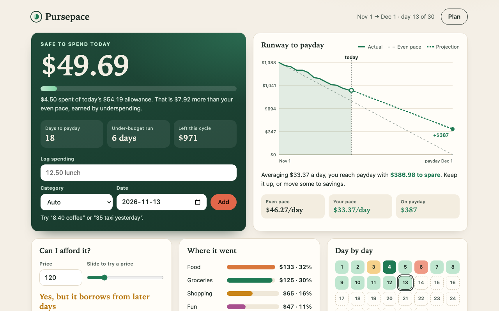

# Pursepace

> A budget that answers one question: how much can I safely spend today?

**[▶ Try the live demo](https://ashwin2310.github.io/one-app-a-day/apps/2026-11-13/)** · Category: 🛠️ Utility · Day 3 · 2026-11-13

📋 [Read the storyboard](STORYBOARD.md): how the idea was planned, screen by screen.

## The problem

Monthly budgets fail in the middle of the month. A spreadsheet or a banking app tells you what you already spent per category, but not the one thing you need at the checkout: whether today's purchase still leaves enough to reach payday. People who are paid once a month end up either overspending early and scraping through the last week, or being needlessly anxious about money they could actually afford to spend.

**Who it's for:** Anyone paid on a regular cycle who wants to pace their spending money day by day without maintaining a category spreadsheet.

## The solution

Pursepace takes your income, fixed bills and savings target, and turns what is left into a rolling daily allowance that recalculates every day: underspend today and tomorrow's number grows, overspend and the cost is spread across the remaining days. A runway chart projects where you will land on payday at your current pace, and a 'Can I afford it?' check shows exactly what any purchase does to the rest of your cycle before you make it.

## How it works

1. Flexible money = income minus fixed bills minus the savings you want to keep this cycle.
2. Each day's allowance = (flexible money minus everything spent before that day) divided by the days left until payday, so every day's result rolls forward automatically.
3. The runway chart plots remaining money against an even-pace line, then extends your average daily spend to payday to forecast the landing balance or the date the money runs dry.
4. The affordability check re-runs the allowance formula with a hypothetical purchase and reports the new daily number and the per-day cost over the remaining days.
5. Quick-add text such as '12.50 lunch yesterday' is parsed into amount, note, date and a category guessed from keywords.
6. Everything is stored in localStorage as one validated JSON document that can be exported and imported.

## Features

- Big 'safe to spend today' number with a live meter, updated the moment you log an expense
- Rolling daily allowance: unspent money raises tomorrow's allowance, overspending is spread over the days left
- Runway chart with even-pace line, actual spending and a projection to payday, including a 'runs dry' date warning
- 'Can I afford it?' slider that shows what a purchase costs per day for the rest of the cycle, and logs it in one click
- One-line quick add ('8.40 coffee', '35 taxi yesterday') with automatic categorisation
- Day-by-day strip, under-budget streak, and a category breakdown of where the money went
- Plan editor for income, bills, savings, dates and currency, plus JSON export, import, undo and one-click new cycle

## Under the hood

- Pure, immutable state updates: every action returns a new state object, which makes undo a single reference swap
- A single compute() pass derives allowances, streaks, pace and forecast from raw state, so the UI can never drift out of sync
- Hand-built responsive SVG chart drawn with createElementNS and redrawn to the container width, no chart library
- All user text is rendered with textContent and imported files go through a strict sanitiser before touching state
- Local-date arithmetic done on UTC day numbers to stay correct across daylight-saving changes

Built with plain HTML, CSS and vanilla JavaScript: no frameworks, no build step, no backend.

## Try it yourself

1. Open the app: a sample pay cycle is loaded, and the green card shows what is safe to spend today
2. Type '18 lunch' in the quick-add box and press Enter, then watch the number, meter, chart and log update
3. Drag the 'Can I afford it?' slider up until the verdict changes from 'fits in today' to 'borrows from later days'
4. Tap a day in the day-by-day strip to see that day's allowance and spending
5. Open Plan, change a bill or the savings target, and save to see your daily allowance re-pace instantly

## Run it locally

Download this folder and open `index.html` in any browser. That's it.

---

Part of a daily build series: one new app every day, planned, storyboarded and built with Claude Code, then published automatically.
