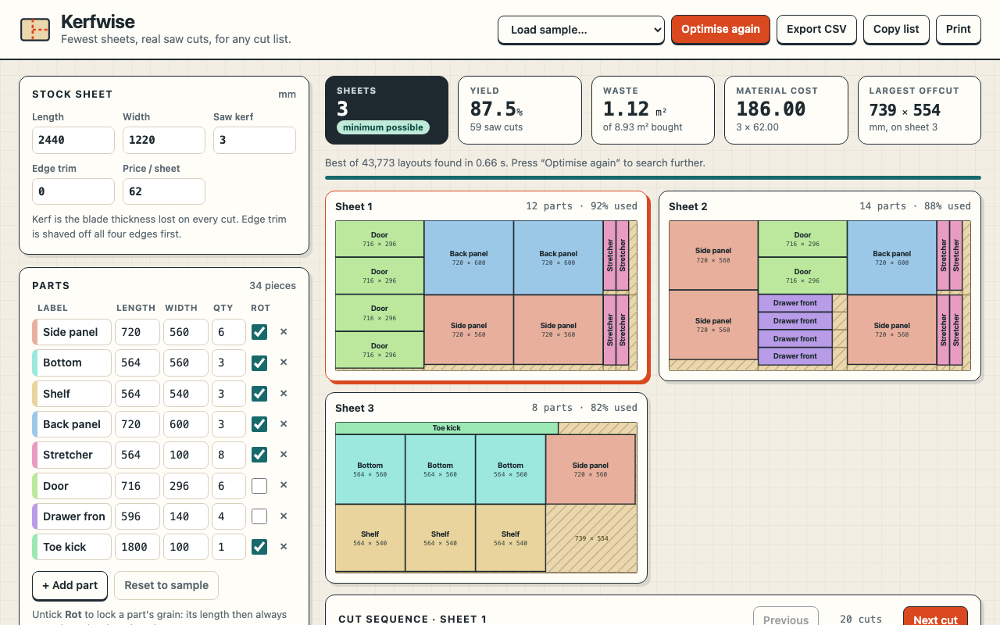

# Kerfwise

> Paste a cut list, get the fewest plywood sheets and the exact order to saw them.

**[▶ Try the live demo](https://ashwin2310.github.io/one-app-a-day/apps/2026-11-15/)** · Category: 🧠 Problem solving / AI · Day 4 · 2026-11-15

📋 [Read the storyboard](STORYBOARD.md): how the idea was planned, screen by screen.

## The problem

Anyone building cabinets, shelves or a workbench has to turn a list of 30-odd rectangular parts into cuts on expensive 2440 x 1220 mm sheets. Sketching layouts by hand wastes material and usually costs one sheet more than needed, and most layouts drawn on paper cannot actually be cut on a table saw or track saw because the cuts do not run edge to edge. Dedicated optimisers exist, but they sit behind sign-ups, part limits or paid plans.

**Who it's for:** Hobby woodworkers, DIY renovators and small joinery shops who buy sheet goods by the sheet and cut them with a table saw, panel saw or track saw.

## The solution

Kerfwise packs your parts onto stock sheets with a guillotine bin-packing search that runs thousands of candidate layouts in the browser in about half a second and keeps the best one. Every layout respects saw kerf, edge trim and grain direction, and because it is built only from edge-to-edge cuts the app can hand you a numbered saw sequence with the fence setting for each cut.

## How it works

1. Each part is expanded by its quantity and inflated by the kerf width, so the blade thickness is paid for exactly once between neighbours and parts can still sit flush against the sheet edge.
2. A guillotine packer places one part at a time into the best free rectangle (best area fit, best short side, best long side or top-left) and then splits the leftover into two new rectangles with a single straight cut, which guarantees the whole sheet can be sawn edge to edge.
3. 120 deterministic strategies are tried first: 6 sort orders x 4 fit rules x 5 split rules.
4. A seeded random hill-climb then swaps parts in the best order and re-rolls the rules until the 650 ms budget runs out, accepting any layout that is no worse.
5. Layouts are ranked by fewest sheets, then by the largest reusable offcut, then by fewest cuts; the sheet count is compared with the area lower bound so the app can say when it is provably minimal.
6. The order parts were placed in is a valid cutting order, so each placement becomes one or two saw steps with the piece to pick up and the fence distance.

## Features

- Live sheet diagrams that rearrange while the search runs, with labelled parts, hatched offcuts and their sizes
- Saw kerf, edge trim and per-part grain lock (untick Rot to keep the grain along the sheet)
- Numbered cut sequence for every sheet: step through it and each cut lights up on the diagram with its fence setting
- Stats at a glance: sheets used, proof when that count is the minimum possible, yield, waste area, material cost and largest offcut
- Fast entry: editable parts table, bulk paste of 'Label, length, width, qty' lines and three sample projects
- Export the layout as CSV, copy a plain-text cut list or print the diagrams
- Autosaves in your browser; nothing is uploaded

## Under the hood

- Guillotine bin packing written from scratch, with four fit heuristics and five split heuristics combined into a portfolio search
- Kerf handled by inflating both the parts and the sheet by one blade width, which keeps the packer free of special cases
- requestAnimationFrame-batched search with a fixed time budget and a seeded PRNG, so results are repeatable and the page never freezes
- Cut sequence derived directly from the packing tree instead of a second solver
- Resolution-independent SVG rendering with non-scaling strokes; zero dependencies and no network requests

Built with plain HTML, CSS and vanilla JavaScript: no frameworks, no build step, no backend.

## Try it yourself

1. Open the app: a 34-part kitchen cabinet job is packed onto sheets while you watch
2. Change the saw kerf from 3 to 10 and watch the parts re-pack around the wider blade
3. Untick Rot on 'Side panel' to lock its grain and watch the parts turn
4. Click a sheet, then press Next cut to walk through the saw sequence
5. Paste your own parts under Bulk paste and export the result as CSV

## Run it locally

Download this folder and open `index.html` in any browser. That's it.

---

Part of a daily build series: one new app every day, planned, storyboarded, built and published automatically.
