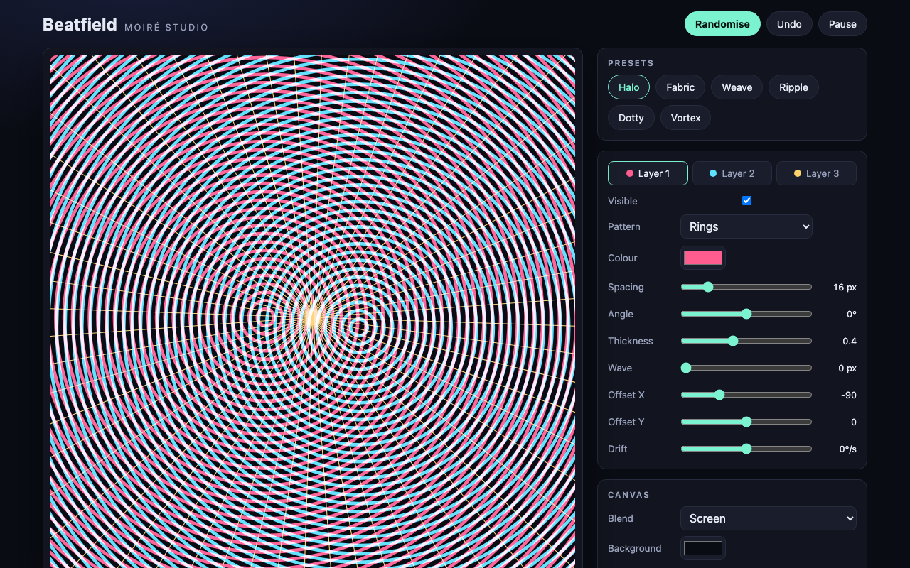

# Beatfield

> A moiré studio: stack three line, ring or dot patterns and watch the interference bloom.

**[▶ Try the live demo](https://ashwin2310.github.io/one-app-a-day/apps/2026-11-16/)** · Category: 🎨 Design · Day 5 · 2026-11-16

📋 [Read the storyboard](STORYBOARD.md): how the idea was planned, screen by screen.

## The problem

Moiré interference is one of the most striking effects in graphic design, but it is almost impossible to design by hand: nudging a single line by a pixel changes the whole picture. Designers either rely on fixed texture packs or write throwaway code, and generative-art tools rarely let you export clean vector results.

**Who it's for:** Designers, poster makers and creative coders who want striking generative backgrounds, wallpapers and cover art without writing code.

## The solution

Beatfield layers up to three procedural patterns (lines, rings, spokes, grids or dots) on one canvas and blends them with screen, difference or multiply. Every spacing, angle, thickness, wave and orbit is a live slider, layers can drift in real time, and the result exports as a crisp PNG or as a true vector SVG.

## How it works

1. Each layer is described by a handful of numbers: pattern type, spacing, angle, thickness, wave, offset and drift.
2. A geometry function turns a layer into one SVG path string, so the exact same path is painted on the canvas through Path2D and written to the SVG export.
3. Layers are rotated around the canvas centre, then offset, so offsets orbit as the angle drifts and create moving beat patterns.
4. Layers are composited with a CSS blend mode (screen, difference, multiply, exclusion) where small spacing differences become large visible bands.
5. The whole design is serialised into the URL hash so any look can be shared as a link.

## Features

- Three independent layers with five pattern types
- Live sliders for spacing, angle, thickness, wave, offset and drift
- Six curated presets plus a one-click randomiser with undo
- Four blend modes and a background colour picker
- Real-time animation with play and pause
- Export as 2000 px PNG or resolution-free SVG
- Shareable link that restores the exact design

## Under the hood

- One geometry function feeds both Canvas (Path2D) and SVG export, so the two outputs always match
- Pure vanilla JS, no libraries, no network requests
- Design state is validated and clamped when loaded from a link
- Honours prefers-reduced-motion by starting paused

Built with plain HTML, CSS and vanilla JavaScript: no frameworks, no build step, no backend.

## Try it yourself

1. Open the page and watch the Halo preset drift.
2. Click a preset such as Weave or Vortex.
3. Drag the Angle slider of layer 2 by a single degree and see the bands swing.
4. Press Randomise until you find a look you love, then Undo if you overshoot.
5. Export SVG or PNG, or copy the link to share it.

## Run it locally

Download this folder and open `index.html` in any browser. That's it.

---

Part of a daily build series: one new app every day, planned, storyboarded and built with Claude Code, then published automatically.
