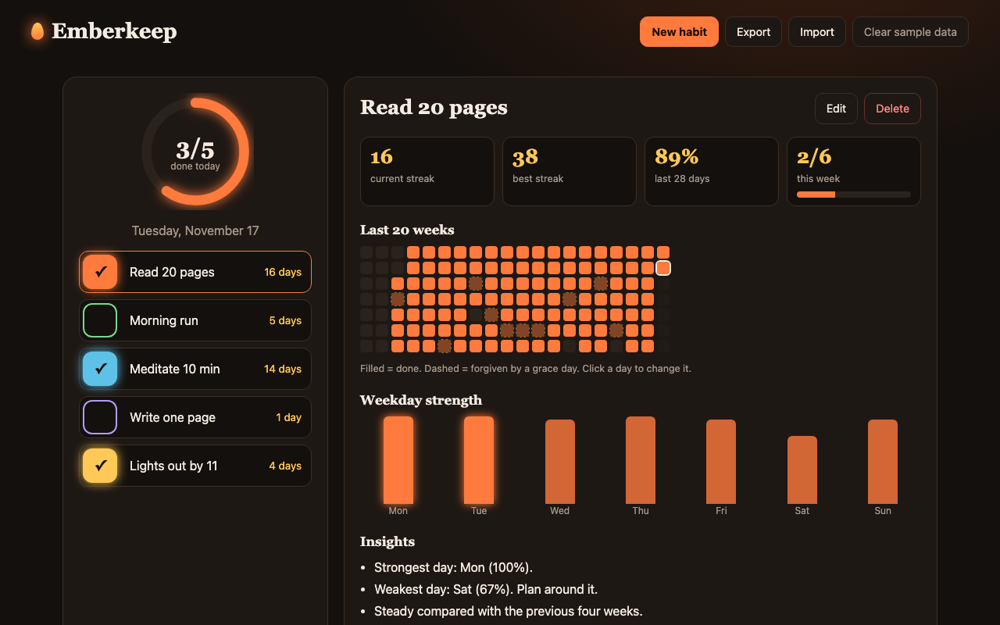

# Emberkeep

> A habit tracker whose streaks forgive one slip a week and show you your real patterns.

**[▶ Try the live demo](https://ashwin2310.github.io/one-app-a-day/apps/2026-11-17/)** · Category: 🛠️ Utility · Day 6 · 2026-11-17

📋 [Read the storyboard](STORYBOARD.md): how the idea was planned, screen by screen.

## The problem

Most habit trackers reset your streak to zero after a single missed day, which turns one bad Tuesday into a reason to quit. They also show a number and little else, so you never learn which weekday you fail on or whether you are improving. People who build habits need motivation that survives imperfect weeks and feedback that is actually specific.

**Who it's for:** Anyone building daily or weekly routines (exercise, reading, sleep, study) who has abandoned a streak counter after one slip.

## The solution

Emberkeep counts a streak with a built-in grace day: one miss per rolling seven days is forgiven, so streaks reflect consistency rather than perfection. Every habit gets a 20-week heatmap, a weekday strength chart and plain-language insights computed from your own history.

## How it works

1. Each habit stores a colour, a weekly target and a set of completed date keys in localStorage.
2. The streak walker steps back from today one day at a time, counting completions.
3. A miss is forgiven if no other miss was forgiven in the previous six days; a second miss inside that window ends the streak.
4. Today is never counted as a miss until the day is over, so an unchecked habit does not break a live streak.
5. Weekday strength is completions divided by opportunities for each day of the week over the last 12 weeks.
6. Insights pick the strongest and weakest weekday and compare the last 4 weeks with the 4 before.

## Features

- One-tap daily check-in with a glowing completion ring
- Streaks with an automatic grace day, shown as a spark when it is used
- 20-week heatmap per habit, click any cell to fix a past day
- Weekday strength bars and written insights
- Weekly targets with a this-week progress meter
- Add, edit and delete habits; export and import JSON backups
- Fully offline, works with keyboard only, responsive to 360px

## Under the hood

- Pure vanilla JS with a single immutable state object and a render function
- Local-date keys avoid timezone and daylight-saving bugs
- Heatmap and charts drawn with CSS grid and inline SVG, no libraries
- Deterministic sample data so the first load already shows rich analytics

Built with plain HTML, CSS and vanilla JavaScript: no frameworks, no build step, no backend.

## Try it yourself

1. Open the app and look at the sample habits and their heatmaps
2. Tick a habit for today and watch the ring and streak update
3. Click a past heatmap cell to mark or unmark that day
4. Add your own habit with the New habit button
5. Use Clear sample data to start fresh

## Run it locally

Download this folder and open `index.html` in any browser. That's it.

---

Part of a daily build series: one new app every day, planned, storyboarded and built with Claude Code, then published automatically.
