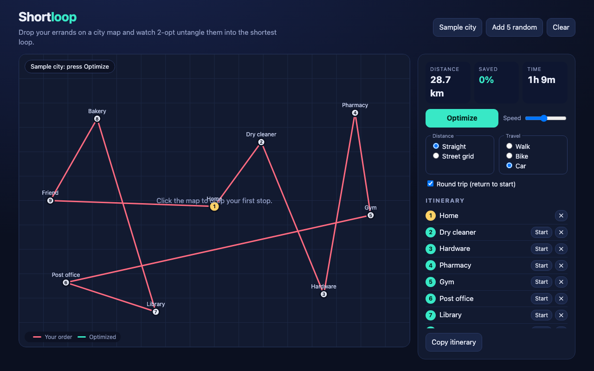

# Shortloop

> Drop your errands on a city map and watch 2-opt untangle them into the shortest loop.

**[▶ Try the live demo](https://ashwin2310.github.io/one-app-a-day/apps/2026-11-19/)** · Category: 🧠 Problem solving / AI · Day 7 · 2026-11-19

📋 [Read the storyboard](STORYBOARD.md): how the idea was planned, screen by screen.

## The problem

Anyone running a Saturday of errands, deliveries or site visits ends up zig-zagging across town because they visit stops in the order they thought of them. Map apps give directions between points but rarely reorder the stops, and real route optimisers are paid, account-gated tools built for fleets.

**Who it's for:** People with a list of stops to hit in one trip: errand runners, couriers, home-visit nurses, field sales reps and weekend planners.

## The solution

Shortloop lets you click stops onto a street-grid map, then solves the travelling-salesman route in your browser. It starts from a nearest-neighbour guess and improves it with 2-opt and Or-opt moves you can watch untangle the path, showing distance and time saved against your original order.

## How it works

1. Your stops become points; the distance between two stops is straight-line or street-grid (Manhattan) distance, whichever you pick.
2. Your own click order is kept as the baseline so savings are measured against what you would really have done.
3. A nearest-neighbour pass builds a decent first loop from the chosen start stop.
4. 2-opt repeatedly reverses a segment of the route whenever that removes two crossing edges and shortens the loop.
5. Or-opt moves runs of one to three stops to a better position in the loop, fixing what 2-opt cannot.
6. The search stops when no move helps, and every improvement is drawn live so you see the tangle resolve.

## Features

- Click to add stops, drag to move them, double-click to remove, and name each one
- Live animated solver with speed control, shown as a before/after route comparison
- Straight-line or street-grid distance, with walking, cycling or driving time estimates
- Pick any stop as the start and choose a round trip or a one-way route
- Sample city presets and a random-stops generator for stress testing up to 60 stops
- Ordered itinerary list you can copy as text, with automatic saving in localStorage

## Under the hood

- 2-opt and Or-opt local search implemented from scratch with an incremental delta check, no libraries
- Solver runs in time slices with requestAnimationFrame so the UI never freezes, even at 60 stops
- HiDPI canvas rendering with an animated route flow and pointer-events based dragging for mouse and touch
- Fully keyboard-operable stop list and a state model that serialises to localStorage

Built with plain HTML, CSS and vanilla JavaScript: no frameworks, no build step, no backend.

## Try it yourself

1. Open the app and press Optimize on the pre-loaded sample city to watch the tangled route resolve.
2. Click the map to add a few of your own stops and drag one to a new spot.
3. Switch distance mode to street grid and notice the route reshape.
4. Press Copy itinerary to take the ordered list with you.

## Run it locally

Download this folder and open `index.html` in any browser. That's it.

---

Part of a daily build series: one new app every day, planned, storyboarded, built and published automatically.
