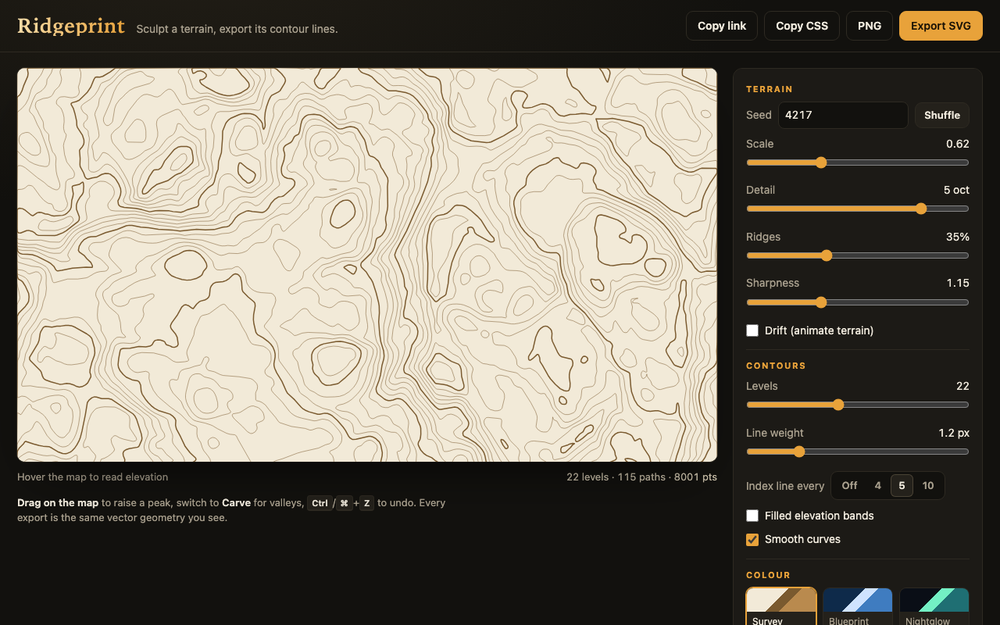

# Ridgeprint

> Sculpt a terrain with your cursor and export its contour lines as clean, layered SVG.

**[▶ Try the live demo](https://ashwin2310.github.io/one-app-a-day/apps/2026-11-21/)** · Category: 🎨 Design · Day 8 · 2026-11-21

📋 [Read the storyboard](STORYBOARD.md): how the idea was planned, screen by screen.

## The problem

Topographic line art is everywhere in posters, slide backgrounds, packaging and outdoor brands, but designers usually grab a stock raster file in the wrong colours or trace one by hand. Real contour lines come from elevation data and an isoline algorithm, so making a custom, editable vector version normally means GIS software or writing code.

**Who it's for:** Designers, illustrators, front-end developers and pen-plotter hobbyists who want a custom topographic pattern they can recolour and edit as vectors.

## The solution

Ridgeprint generates a seeded terrain from layered noise, then traces true contour lines through it with marching squares and joins them into smooth paths. You can raise peaks and carve valleys by painting on the map, restyle everything live, and export a tidy SVG, a PNG or a ready-to-paste CSS background.

## How it works

1. A height field is built on a grid from several octaves of seeded value noise, shaped by a ridge and sharpness control and any hills or valleys you paint.
2. Heights are normalised to 0..1 and split into evenly spaced contour levels.
3. For every level, marching squares inspects each grid cell's four corners and emits the line segment where the terrain crosses that height, interpolated along the cell edges.
4. Loose segments are stitched end to end into long polylines and closed rings using an endpoint hash, so each contour is one path instead of thousands of fragments.
5. Paths are smoothed with Chaikin corner cutting and drawn to canvas, with every Nth line drawn heavier as an index contour, like a real survey map.
6. Exports reuse the same paths, so the SVG has one grouped path per level and matches the screen exactly.

## Features

- Paint to raise hills or carve valleys, with brush size and strength, plus undo
- Live sliders for seed, scale, detail, ridge sharpness, number of levels and line weight
- Index contours every Nth level and an optional filled elevation-band mode
- Six curated palettes plus custom ink and paper colours
- Export layered SVG, a 2x PNG, or copy a CSS background-image snippet
- Shareable link that encodes the whole design, and automatic saving in localStorage

## Under the hood

- Marching squares with saddle-case disambiguation and edge interpolation, written from scratch
- Segment stitching through a quantised endpoint map turns fragments into continuous paths in linear time
- Seeded PRNG and value noise make every design reproducible from a short settings string
- Rendering is debounced into requestAnimationFrame so dragging sliders and painting stay smooth

Built with plain HTML, CSS and vanilla JavaScript: no frameworks, no build step, no backend.

## Try it yourself

1. Open the app and look at the pre-generated mountain range, then press Shuffle seed a few times.
2. Pick the Raise brush and drag across the map to push up a new ridge; switch to Carve to cut a valley.
3. Change the palette to Blueprint and turn on Filled bands.
4. Press Export SVG and open the file in your design tool: every contour is a clean editable path.

## Run it locally

Download this folder and open `index.html` in any browser. That's it.

---

Part of a daily build series: one new app every day, planned, storyboarded, built and published automatically.
