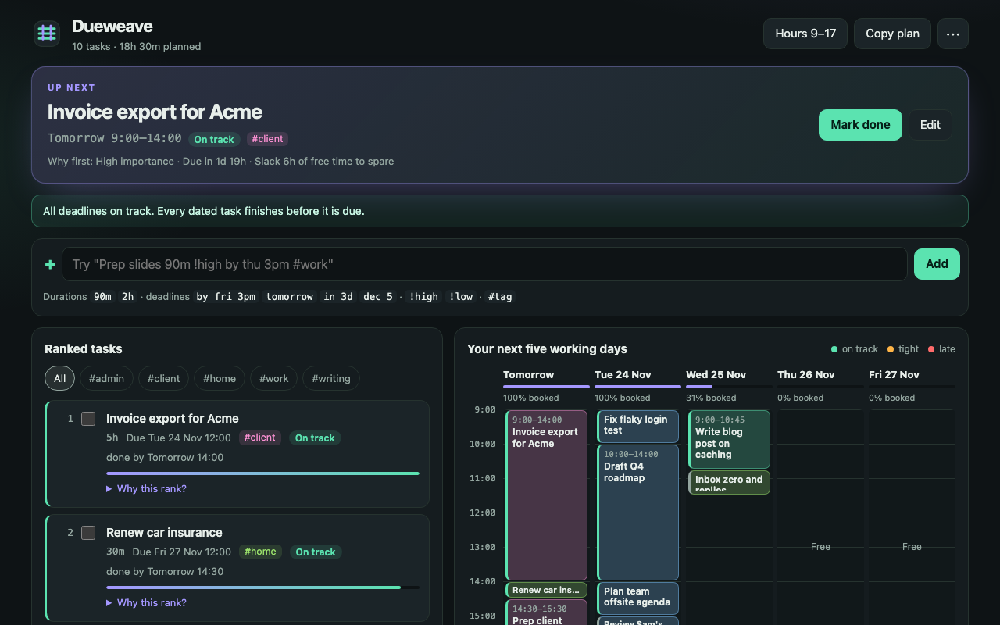

# Dueweave

> A to-do list that plans your working hours and warns you before a deadline slips.

**[▶ Try the live demo](https://ashwin2310.github.io/one-app-a-day/apps/2026-11-22/)** · Category: 🛠️ Utility · Day 9 · 2026-11-22

📋 [Read the storyboard](STORYBOARD.md): how the idea was planned, screen by screen.

## The problem

Most to-do lists are just ordered piles: they know a task is due Friday but not that it needs six hours and you only have four free before then. People who juggle many deadlines find out a task is late when it is already late, and re-ordering the list by hand every morning eats the time it was meant to save. Calendar time-blocking tools fix this, but they are heavy, paid and need every task dragged in manually.

**Who it's for:** Freelancers, students, engineers and anyone with a pile of tasks, real deadlines and a fixed number of working hours.

## The solution

Dueweave reads a single line like "Prep slides 90m !high by thu 3pm #work", ranks every task by importance, deadline slack and effort, then lays the ranked list onto your actual working hours for the next few days. It runs a deadline check on the plan, pulls late tasks forward when that fixes them, and tells you plainly which ones are still at risk and by how much.

## How it works

1. A quick-add parser pulls duration (90m, 1h30m), importance (!high, !low), deadline (today, fri, in 3d, dec 5, 5pm) and #tag out of one typed line and shows the parsed fields live as chips.
2. Your working hours (for example 9:00 to 17:00, weekdays) become a list of free time slots starting from the current moment.
3. For each deadline the app sums the work of every task due at or before it (earliest-deadline-first) and compares it with the free hours until then; the difference is that task's slack.
4. A priority score combines importance, an urgency curve that rises as slack shrinks, a small boost for quick wins and an ageing boost so undated tasks never starve.
5. Tasks are placed into the slots in score order and split across slot boundaries; a repair pass then moves any late task ahead of tasks with later or no deadlines until the plan stops improving.
6. Each task is labelled on track, tight or late (with the exact overrun), and the first block of the plan becomes the Up next card.

## Features

- One-line quick add with natural-language durations, deadlines, importance and tags, previewed live
- Auto-planned timeline of the next five working days, with tasks split across days when needed
- Deadline risk badges: on track, tight, or late by an exact amount, plus an overbooked warning
- Up next card that says what to do now and why it beat everything else
- Explain panel on every task showing slack, due time, importance and age behind its score
- Tag filters, inline edit dialog, completion with undo, and adjustable working hours and weekends
- Everything saved in localStorage, with one-click copy of the plan as plain text

## Under the hood

- Earliest-deadline-first feasibility check computes per-task slack against real free hours, not wall-clock time
- Greedy slot packing with chunk splitting, followed by a bounded deadline-repair pass that only ever moves late tasks earlier
- Hand-written tokenizer for durations, weekdays, relative days, month dates and clock times with no date library
- Single render function from immutable state; the timeline is the same data shown as positioned blocks on desktop and as an agenda list at 360px
- Plain HTML, CSS and vanilla JavaScript with zero dependencies or network requests

Built with plain HTML, CSS and vanilla JavaScript: no frameworks, no build step, no backend.

## Try it yourself

1. Look at the Up next card and the five-day timeline built from the sample tasks.
2. Type "Tax forms 3h !high by tomorrow 2pm #home" into the quick-add bar, watch the chips, and press Enter.
3. Notice which tasks turned amber or red, then open "Why this rank?" on one of them.
4. Change working hours to 10 to 16 in Hours and watch the plan and risk badges update.
5. Tick a task done, then hit Undo in the toast to bring it back.

## Run it locally

Download this folder and open `index.html` in any browser. That's it.

---

Part of a daily build series: one new app every day, planned, storyboarded and built with Claude Code, then published automatically.
