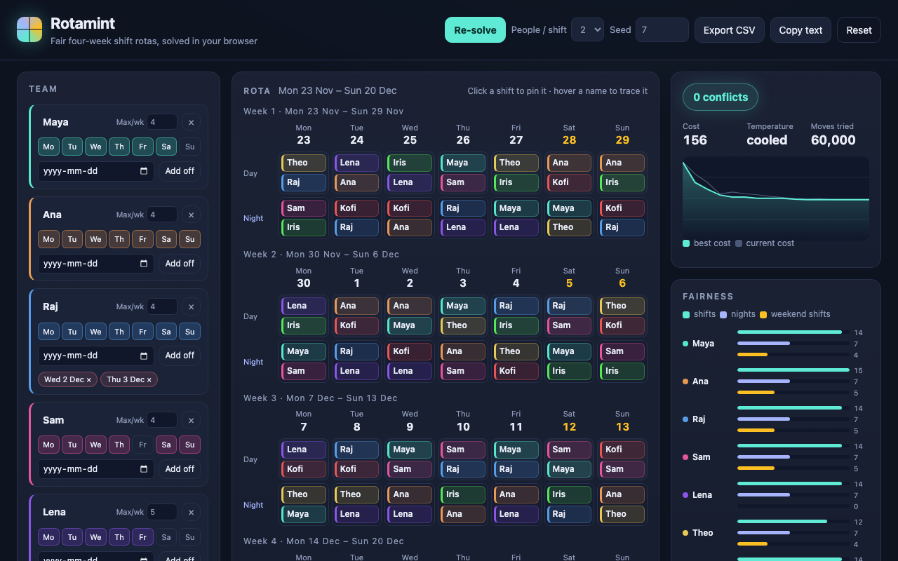

# Rotamint

> Drop in your team and their limits; simulated annealing hands back a fair 4-week rota.

**[▶ Try the live demo](https://ashwin2310.github.io/one-app-a-day/apps/2026-11-23/)** · Category: 🧠 Problem solving / AI · Day 10 · 2026-11-23

📋 [Read the storyboard](STORYBOARD.md): how the idea was planned, screen by screen.

## The problem

Small teams, clinics, volunteer groups and on-call crews still build shift rotas by hand in spreadsheets. Juggling availability, time off, no night-then-morning turnarounds and fair weekend shares means someone always ends up unhappy, and every change breaks something else. Scheduling suites that solve this are heavy, paid and built for enterprises.

**Who it's for:** Team leads, shop and clinic managers, and volunteer coordinators who need a fair rota in minutes without paid software.

## The solution

Rotamint takes each person's weekly availability, time off and weekly cap, then searches thousands of rota candidates with simulated annealing written from scratch. You watch the cost fall live, pin the assignments you care about, re-solve around them, and export the result as CSV or text.

## How it works

1. Every day has a Day and a Night shift, each needing a chosen number of people; the rota is one grid of person slots.
2. A cost function adds penalties: unavailable people, double bookings, night-then-day turnarounds, long streaks, weekly caps, and unequal shifts, nights and weekends.
3. Simulated annealing starts from a random rota, proposes a change or swap, and accepts worse moves with a probability that shrinks as the temperature cools.
4. Pinned slots are never touched, so you can lock a person in and let the solver rebuild everything around them.
5. A seeded random generator makes every run reproducible, and the best rota seen is kept.

## Features

- Live solver with an animated cost curve and temperature readout
- Per-person weekday availability, weekly cap and dated time off
- Click any assignment to pin it, then re-solve around the pins
- Fairness bars for total shifts, nights and weekends per person
- Plain-language rule report listing any remaining conflicts
- Hover a person to highlight all their shifts
- Export as CSV or copy as text; everything saves in the browser

## Under the hood

- Simulated annealing with geometric cooling, written from scratch
- Seeded mulberry32 PRNG for reproducible rotas
- Solver runs in animation-frame chunks so the UI never freezes
- Pure DOM rendering with textContent, so names can never inject markup
- No dependencies, no network, state kept in localStorage

Built with plain HTML, CSS and vanilla JavaScript: no frameworks, no build step, no backend.

## Try it yourself

1. Open the page: a sample team is already solved, so look at the fairness bars.
2. Switch Maya's Friday off in her card, then press Re-solve and watch the cost curve.
3. Click a few assignments to pin them, raise people per shift, and solve again.
4. Add a time-off date for someone and see the rule report stay clean.
5. Press Export CSV to take the rota with you.

## Run it locally

Download this folder and open `index.html` in any browser. That's it.

---

Part of a daily build series: one new app every day, planned, storyboarded, built and published automatically.
