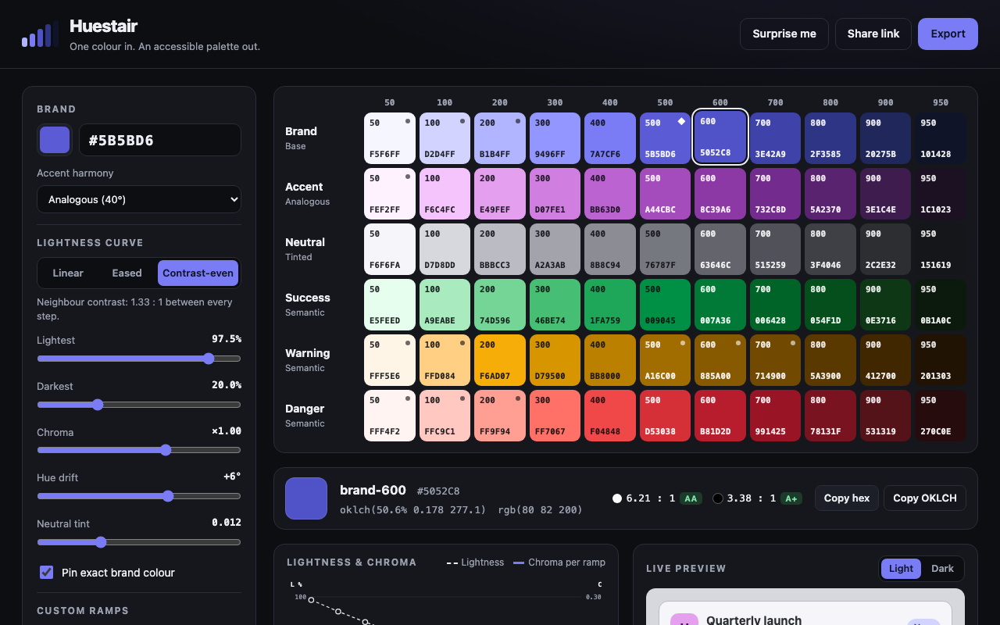

# Huestair

> Turn one brand colour into a full OKLCH palette whose steps are evenly spaced by contrast.

**[▶ Try the live demo](https://ashwin2310.github.io/one-app-a-day/apps/2026-11-24/)** · Category: 🎨 Design · Day 11 · 2026-11-24

📋 [Read the storyboard](STORYBOARD.md): how the idea was planned, screen by screen.

## The problem

Design systems need ten or more shades of every colour, but most palette tools just mix the base with white and black in RGB or HSL. That gives muddy darks, washed-out lights, uneven jumps between steps and shades that silently fail WCAG contrast, so designers end up hand-tweaking dozens of hex codes and rechecking each text pair one at a time.

**Who it's for:** Product designers, front-end developers and design-system maintainers who need accessible, consistent colour scales for a brand, a UI kit or a Tailwind theme.

## The solution

Huestair builds every scale in the perceptual OKLCH colour space and can space its lightness so each step has the same contrast ratio to the next, then gamut-maps every shade back into sRGB so nothing clips. It derives a tinted neutral, a harmony accent and semantic success, warning and danger ramps from your one brand colour, shows a live contrast matrix and a light and dark UI preview, and exports CSS variables, a Tailwind theme, design tokens or an SVG swatch sheet.

## How it works

1. Your base hex is converted to OKLCH (perceptual lightness, chroma, hue) with Björn Ottosson's OKLab matrices.
2. Eleven lightness targets from step 50 to 950 are laid out between a lightest and darkest value, either linearly, eased, or contrast-even: WCAG luminance + 0.05 is spaced geometrically so every neighbouring pair has the same contrast ratio.
3. Chroma follows a bell curve that peaks at the step nearest your base colour and tapers toward the light and dark ends, and hue drifts by a few degrees so lights turn warmer and darks deeper, like a hand-made scale.
4. The step closest to your base can be pinned to the exact base colour so the brand hex always appears in the palette.
5. Every shade is gamut-mapped by binary-searching the largest chroma that still fits in sRGB, keeping its lightness and hue intact.
6. WCAG 2 contrast ratios are computed from relative luminance for every pair of steps, feeding the contrast matrix, the AA/AAA badges and the UI preview.

## Features

- One brand colour generates six ramps: brand, harmony accent, tinted neutral, success, warning and danger
- Lightness curve choice (linear, eased, contrast-even) plus sliders for lightest, darkest, chroma and hue drift
- Live lightness and chroma chart for every ramp, and an 11 x 11 contrast matrix with AA and AAA marks
- Light and dark UI preview built only from the generated palette
- Click any swatch to inspect its hex, OKLCH, RGB and contrast on white and black, and copy it
- Export CSS custom properties (hex or oklch), a Tailwind colours block, W3C design tokens JSON or an SVG swatch sheet
- Add your own ramps, a Surprise me button, a shareable link and automatic saving

## Under the hood

- OKLab/OKLCH conversion and sRGB gamut mapping written from scratch, with no colour library
- Contrast-even lightness: luminance targets are placed geometrically so neighbour contrast is constant, then converted back to OKLab lightness
- Chroma reduction by binary search preserves perceived lightness and hue instead of clipping RGB channels
- The whole palette state is serialised into the URL hash and localStorage, and every export is generated from the same computed scale

Built with plain HTML, CSS and vanilla JavaScript: no frameworks, no build step, no backend.

## Try it yourself

1. Open the app and look at the generated indigo system and the light and dark preview beside it.
2. Paste your own brand hex into the Brand field and watch all six ramps and the preview rebuild.
3. Switch the curve to Contrast-even and check the contrast matrix: the diagonal bands become perfectly regular.
4. Click a swatch to inspect it, then press Export and copy the Tailwind block into your project.

## Run it locally

Download this folder and open `index.html` in any browser. That's it.

---

Part of a daily build series: one new app every day, planned, storyboarded, built and published automatically.
