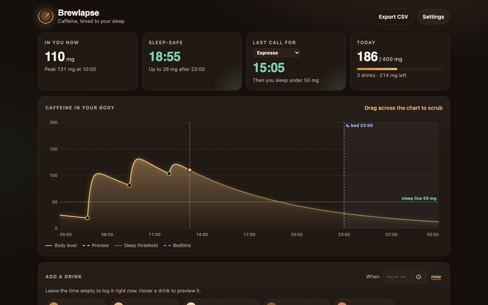

# Brewlapse

> A caffeine tracker that tells you your last safe coffee before bed.

**[▶ Try the live demo](https://ashwin2310.github.io/one-app-a-day/apps/2026-11-27/)** · Category: 🛠️ Utility · Day 12 · 2026-11-27

📋 [Read the storyboard](STORYBOARD.md): how the idea was planned, screen by screen.

## The problem

Caffeine has a half-life of about five hours, so the 3 pm flat white is still half in your system at 8 pm and a quarter at bedtime. Most people only count cups or milligrams per day, which says nothing about what is still active when they try to sleep. Typical caffeine trackers log drinks against a daily limit but never answer the question that matters in the afternoon: can I have another one?

**Who it's for:** Coffee and tea drinkers, students, shift workers and anyone whose sleep suffers from caffeine and who wants a quick, honest answer before the next cup.

## The solution

Brewlapse logs drinks with one tap and runs a pharmacokinetic model of every dose, absorption and elimination included, to draw a live curve of the caffeine in your body across the day. It works out the moment you drop below your sleep threshold and the latest time you could have one more drink and still be under it all night. Hover any drink to see a ghost curve of the effect before you have it.

## How it works

1. Each drink is modelled as a one-compartment dose with first-order absorption (peak about 45 minutes after drinking) and first-order elimination set by your half-life.
2. The body level at any moment is the sum of every dose's Bateman curve, including carry-over from the evening before.
3. Sleep-safe time is found by scanning forward in five-minute steps for the moment the total stays below your threshold for the rest of the night.
4. Last call tries the selected drink at every five-minute slot from now to bedtime and keeps the latest slot whose peak during the night stays under the threshold.
5. A seven-day history records the total per day and the level at bedtime, and drives the weekly insight sentence.

## Features

- One-tap logging from nine common drinks, or at any time you choose, plus your own custom drinks
- Live 24-hour curve with threshold line, bedtime marker, now marker and drag-to-scrub readout
- Last call: the latest time the selected drink still lets you sleep under your threshold
- Ghost preview: hover or focus a drink to see its curve and its effect at bedtime before logging it
- Seven-day strip of daily totals and bedtime levels; tap any day to view or edit it
- Personal settings for bedtime, half-life, sleep threshold and daily limit, saved in your browser
- Export of the full log as CSV and a one-click reset

## Under the hood

- Closed-form Bateman equation per dose, summed analytically, so the curve is exact rather than simulated step by step
- Search-based solvers for sleep-safe time and last call that account for overnight peaks, not just the level at bedtime
- Hand-built responsive SVG chart with pointer and keyboard scrubbing, no chart library
- All state in one immutable object persisted to localStorage, with sample history seeded on first visit

Built with plain HTML, CSS and vanilla JavaScript: no frameworks, no build step, no backend.

## Try it yourself

1. Look at the curve: the mint line is your sleep threshold and the moon marks bedtime.
2. Hover the Cold brew button and watch the ghost curve show what it would do to your night.
3. Tap Espresso to log one now and see Sleep-safe and Last call update.
4. Open Settings and change your half-life from 5 to 8 hours to see how slow metabolisers fare.
5. Tap an earlier day in the week strip to review it.

## Run it locally

Download this folder and open `index.html` in any browser. That's it.

---

Part of a daily build series: one new app every day, planned, storyboarded, built and published automatically.
