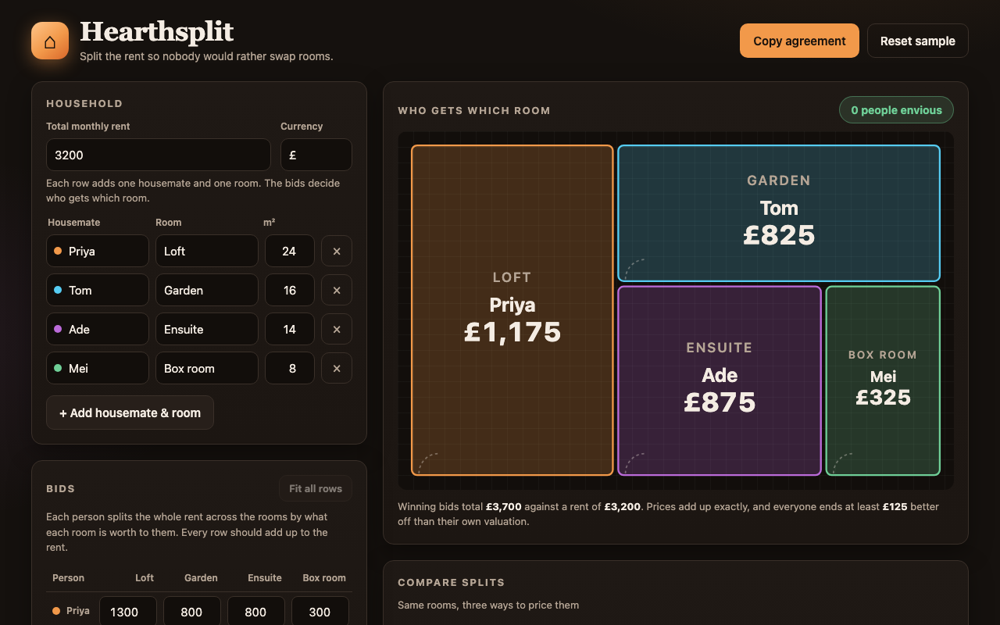

# Hearthsplit

> Split rent across unequal rooms so nobody would rather swap, with the proof on screen.

**[▶ Try the live demo](https://ashwin2310.github.io/one-app-a-day/apps/2026-11-28/)** · Category: 🧠 Problem solving / AI · Day 13 · 2026-11-28

📋 [Read the storyboard](STORYBOARD.md): how the idea was planned, screen by screen.

## The problem

When housemates share a flat with a big bedroom, a box room and one ensuite, splitting the rent equally or by floor area almost always leaves someone quietly resentful. People value rooms differently (light, noise, a private bathroom), and haggling over it is awkward. Spreadsheets give you a number but no reason to trust it, and the fair-division tools that exist are buried in academic sites or need an account.

**Who it's for:** Housemates, couples moving in with friends, and student groups who need to agree on who gets which room and what each person pays.

## The solution

Each person spreads the total rent across the rooms according to how much they would pay for each one. Hearthsplit finds the room assignment that maximises total happiness, then computes prices so that no one would trade their room-and-price deal for anyone else's. It shows an envy table proving it and compares the result with equal and by-area splits.

## How it works

1. Every housemate enters bids: how they would divide the full rent across the rooms, so each row sums to the rent.
2. The Hungarian algorithm (O(n³)) assigns rooms so that the sum of winning bids is as large as possible. Envy-free prices only exist for such an assignment.
3. Envy-freeness becomes difference constraints: price(mine) − price(theirs) ≤ my bid(mine) − my bid(theirs) for every pair of rooms.
4. Bellman-Ford shortest paths from a virtual source solve those constraints, capping each price at the winner's own bid.
5. The solution is shifted evenly so the prices add up exactly to the rent. This choice also provably maximises the smallest person's surplus (the maximin fairness target).
6. An envy matrix checks every person against every room, and the same check is run on equal and by-area splits for comparison.

## Features

- Live solve: change any bid, the rent or a room size and the assignment, prices and proof update instantly
- Procedural floor plan that sizes rooms by area and colours each one by who gets it, with the price on the door
- Envy proof matrix: every person × every room, showing how much better off each person is with their own deal
- Side-by-side comparison with equal and by-area splits that counts how many people would envy someone
- Plain-English receipt per person, plus one-click copy of the whole agreement to paste in the group chat
- 2 to 8 housemates, any currency symbol, a 'fit row to rent' helper, and autosave in your browser

## Under the hood

- Hungarian algorithm with potentials written from scratch for the maximum-welfare assignment
- Envy-free pricing as a system of difference constraints solved with Bellman-Ford, with negative-cycle detection as a safety check
- Closed-form maximin shift: subtracting the same amount from every price keeps it envy-free and makes it sum to the rent
- Floor plan drawn as SVG with a recursive area-balanced binary split, so it reflows for any number of rooms
- Zero dependencies: vanilla JS, no network requests, state persisted to localStorage

Built with plain HTML, CSS and vanilla JavaScript: no frameworks, no build step, no backend.

## Try it yourself

1. Open the page: four housemates and a sample flat are already solved, with every room priced
2. Look at the 'Compare' card: an equal split leaves several people envious, Hearthsplit leaves none
3. Raise Priya's bid for the Loft and watch the assignment and prices rebalance live
4. Add a fifth housemate and room, give it a size, and press 'Fit' on each row to rebalance bids
5. Press 'Copy agreement' and paste the plain-text summary into your group chat

## Run it locally

Download this folder and open `index.html` in any browser. That's it.

---

Part of a daily build series: one new app every day, planned, storyboarded, built and published automatically.
